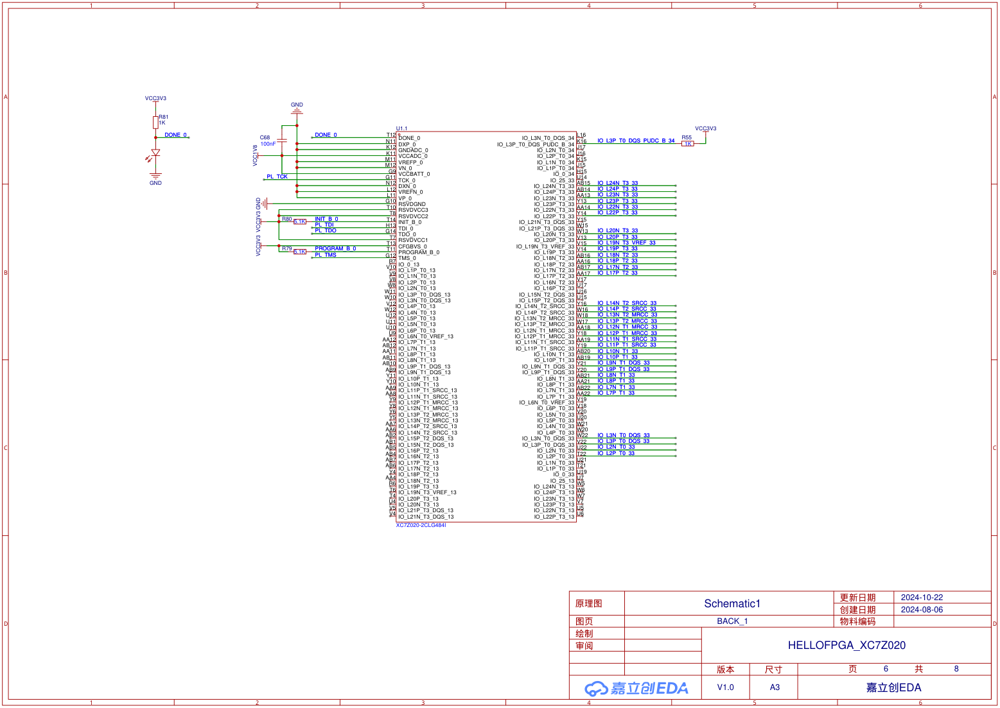

# 测量头与模拟前端

当前接线参考来自最新114审查所核对实图：OPA189共用缓冲，Rs为100Ω/10kΩ；K5选择采样来源，K6选择量程，K7选择VA/VB。实际Rs数值和通路标定以装配后的实测记录为准。

上图作为团队接线参考，尚不表示实际输入阻抗、保护、切换稳定性和幅相精度已验收。早期OPA810三路缓冲、默认1kΩ属于旧候选，不与当前接线混用。

详细测量角色、相量公式和切换问题见[测量流程](../docs/测量流程与故障特征.md)。
